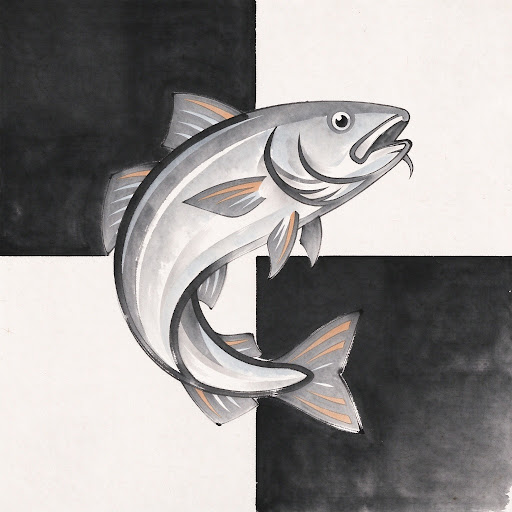
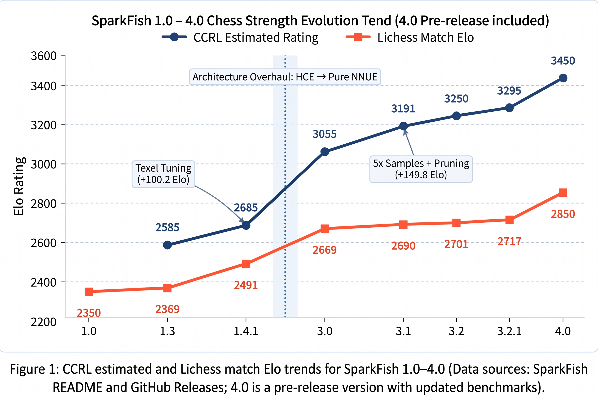

# SparkFish 4.0 Manual


<div align="center">
  
  <h1>SparkFish 4.0</h1>
  <p>A lite chess engine with NNUE</p>
  <p>Supported:Android OEX /Windows</p>
  <div align="center">

SparkFish is a powerful Chess engine using K32H3 NNUE to perform accurate attck and defence.Born to be one of the most strongest engines.
Also have 3 Style to choose:Aggressive,Normal,Solid.Change it,and Challenge all kinds of opponents.

<div align="center">
  <p>
    <a href="LICENSE"></a>
    <a href="https://github.com/Lester-chess/SparkFish-NNUE-Chess-Engine/releases/latest"></a>
    <a href="https://github.com/Lester-chess/SparkFish-NNUE-Chess-Engine/commits/main"></a>
    <a href="https://github.com/Lester-chess/SparkFish-NNUE-Chess-Engine"></a>
  </p>
  <p>
    <a href="https://en.wikipedia.org/wiki/C%2B%2B20"></a>
    <a href="https://github.com/Lester-chess/SparkFish-NNUE-Chess-Engine"></a>
    <a href="https://en.wikipedia.org/wiki/Universal_Chess_Interface"></a>
    <a href="https://github.com/Lester-chess/SparkFish-NNUE-Chess-Engine/releases"></a>
    <a href="https://github.com/Lester-chess/SparkFish-NNUE-Chess-Engine/releases"></a>
  </p>
  <p>
    
    
    
    
  </p>
  <p>

<!-- AVX2 指令集加速 -->

<a href="https://github.com/Lester-chess/SparkFish-NNUE-Chess-Engine/releases"></a>
</p>
</div>


◀️Time control:[Lichess Blitz/rapid/bullet](https://lichess.org/@/SparkchessEngine)

✨CCRL [blitz benchmark](https://www.computerchess.org/).

| Rank | Name | CCRL(Estimated) | Elo(Lichess) | + | - | games | score | oppo. | draws |
| :---: | :--- | :---: | :---: | :---: | :---: | :---: | :---: | :---: | :---: |
| 1 | [SparkFish 3.2.1](https://github.com/Lester-chess/SparkFish/releases/tag/v3.2.1) | 3295| 2717 | 0 | 0 | 0 | 0 | 0 | 0 |
| 2 | [SparkFish 3.2.0](https://github.com/Lester-chess/SparkFish/releases/tag/v3.2.0) | 3250 | 2701 | 0 | 0 | 0 | 0 | 0 | 0 |
| 3 | [SparkFish 3.1.0](https://github.com/Lester-chess/SparkFish/releases/tag/v3.1.0) | 3191 | 2690 | 0 | 0 | 0 | 0 | 0 | 0 |
| 4 | [SparkFish 3.0.0](https://github.com/Lester-chess/SparkFish/releases/tag/v3.0) | 3055 | 2669 | 0 | 0 | 0 | 0 | 0 | 0 |
| 5 | [SparkFish 1.4.1](https://github.com/Lester-chess/SparkFish/releases/tag/v1.4.1) | 2685 | 2491 | 0 | 0 | 0 | 0 | 0 | 0 |
| 6 | [SparkFish 1.3.0](https://github.com/Lester-chess/SparkFish/releases/tag/v1.3) | 2585 | 2369 | 0 | 0 | 0 | 0 | 0 | 0 |
| 7 | [SparkFish 1.0.0](https://github.com/Lester-chess/SparkFish/releases/tag/v1.0) | 2450 | 2350 | 0 | 0 | 0 | 0 | 0 | 0 |
---



</div>
</div>

Estimated ELO of SparkFish 4.1 DEVL1:     1 Thread /128MB hash /Book:8moves_v3.pgn,Time control:40+0.4(s)
```bash
# Score of SparkFish 4.1 l1 vs Komodo 14.1: 176 - 106 - 168  [0.578] 450
# ...      SparkFish 4.1 l1 playing White: 152 - 14 - 59  [0.807] 225
# ...      SparkFish 4.1 l1 playing Black: 24 - 92 - 109  [0.349] 225
# ...      White vs Black: 244 - 38 - 168  [0.729] 450
# Elo difference: 54.5 +/- 25.5, LOS: 100.0 %, DrawRatio: 37.3 %
SPRT: llr 2.97 (100.8%), lbound -2.94, ubound 2.94 - H1 was accepted
```

SparkFish is tested to prove that it is a little bit stronger than the Last version of Komodo.The next goal is to catch up with dragon 1.Due to my pc specs,i can not do toomuch game

## 1. System Requirements & Installation

### 1.1 Requirements
- **Linux** (Ubuntu 20.04+ recommended) or **Windows** (10/11 x86_64)
- **Compiler**: GCC / G++ (v9.0+ supporting C++17) or MSVC
- **Dependencies**: OpenMP (for multi-threaded tuning)
- **Compatibility Layer (Optional)**: Wine (required only if running Windows `.exe` on Linux instances)

### 1.2 Compilation from Source

#### On Linux (Native / AutoDL / VPS)
```bash
# Clone the repository
git clone [https://github.com/your-repo/sparkchess.git](https://github.com/your-repo/sparkchess.git)
cd sparkchess

# Build using G++ with optimization flags
g++ -O3 -std=c++17 -fopenmp -march=native src/*.cpp -o bin/sparkchess

# Grant executable permissions
chmod +x bin/sparkchess
```

#### On Windows:PGO,use MSVC
```bash
# 1. Compile SYZYGY part
cl /nologo /I syzygy /std:c11 /experimental:c11atomics /O2 /Oi /GL /arch:AVX2 /DNDEBUG /D_CRT_SECURE_NO_WARNINGS /c syzygy\tbprobe.c

# 2. Compile PGO -gen version
cl /nologo /I syzygy /std:c++20 /O2 /Oi /GL /arch:AVX2 /DNDEBUG /EHsc /Fe:SparkFish_AVX2_Gen.exe main.cpp tbprobe.obj nnue_embed.res /link /LTCG /GENPROFILE /STACK:8388608

# 3. Run bench and prepare for final compile
SparkFish_AVX2_Gen.exe bench

(echo uci & echo isready & echo position startpos & echo go depth 14 & echo position fen r3k2r/p1ppqpb1/bn2pnp1/3PN3/1p2P3/2N2Q1p/PPPBBPPP/R3K2R w KQkq - 0 1 & echo go depth 13 & echo position fen 8/2p5/3p4/KP5r/1R3p1k/8/4P1P1/8 w - - 0 1 & echo go depth 16 & echo quit) | SparkFish_AVX2_Gen.exe

#4. Compile final version using pgo files
cl /nologo /I syzygy /std:c++20 /O2 /Oi /GL /arch:AVX2 /DNDEBUG /EHsc /Fe:SparkFish_AVX2.exe main.cpp tbprobe.obj nnue_embed.res /link /LTCG /USEPROFILE /PGD:SparkFish_AVX2_Gen.pgd /STACK:8388608

```
## 2. Basic UCI Usage

SparkChess conforms to the standard UCI protocol. Launch the executable from a terminal or connect it to any chess GUI (Arena, Cutechess, Bankia, Fritz).

### 2.1 Interactive Terminal Mode
Start the engine directly:
```bash
./sparkchess
```

Common UCI commands:
```text
uci                       # Initialize engine and print engine parameters
isready                   # Check if engine is ready (replies 'readyok')
setoption name Threads value 8
setoption name Hash value 256
position startpos moves e2e4 e7e5
go depth 15               # Search to depth 15
go wtime 300000 btime 300000 winc 2000 binc 2000  # Timed search
quit                      # Terminate the engine
```

---

## 3.Pytorch NNUE Trainer Manual
# NNUE PyTorch Trainer User Guide

This document provides instructions on how to set up and use the NNUE PyTorch trainer for model training and exporting. Depending on your local environment setup preferences, the guide is divided into two scenarios: **Training without a Virtual Environment** and **Training with a Virtual Environment**.

## Scenario 1: Training without a Virtual Environment

If you are training directly in your system's global Python environment, please follow the steps below:

### 1. Environment Preparation & Dependency Installation

1. **Python Version Requirement**: **Python 3.11** is recommended.

2. **Install Basic Dependencies**: Open Command Prompt (CMD) in the root directory of the trainer and use `pip` to install the required dependencies listed in `requirements.txt`:

```cmd
pip install -r requirements.txt
```

3. **Install PyTorch (CUDA Version)**: Based on your current Python version and GPU driver support, visit the [Official PyTorch Website](https://pytorch.org/get-started/locally/) to obtain and run the appropriate installation command for CUDA-accelerated PyTorch.

4. **Compile the Data Loader**: Navigate to the trainer folder and run the batch script to generate `training_data_loader.dll`:

```cmd
build-dataloader-windows.bat
```

### 2. Dataset Preparation & Starting the Training

1. **Obtain the Dataset**:
   You can download `.binpack` dataset files from the official HuggingFace repository:

   * Dataset URL: [official-stockfish/master-binpacks](https://huggingface.co/datasets/official-stockfish/master-binpacks/tree/main)

   * **Training Recommendation**: It is recommended to use a dataset of around **30-40GB** and better to mix 4-5 binpacks and train for **70-80 epochs**.Estimated Training time 3-4 Hours.

2. **Run the Training Command**:
   Once the preparation is complete, run the following command in the command line to start training:

```cmd
python train.py "1.binpack" "2.binpack" "3.binpack" "4.binpack" --features="HalfKAv2^" --l1=1024 --max-epochs=x
```

   > **Parameter Description**:
   >
   > * `"path/to/your_dataset.binpack"`: Replace this with the actual file path and name of your `.binpack` dataset.
   >
   > * `--max-epochs=x`: Replace `x` with your desired number of training epochs (e.g., `--max-epochs=25`).

### 3. Exporting (Serializing) the NNUE Model File

After training is complete, you need to convert the generated checkpoint file (`.ckpt`) into the `.nnue` format usable by the engine.

1. **Run the Serialization Command**:

```cmd
python serialize.py "logs\training_logs\version_x\checkpoints\last.ckpt" "..\engine\custom_512x2.nnue" --features="HalfKAv2^" --l1=1024 --l2=16 --l3=32
```

   > **Note**: `version_x` in the path (e.g., `version_0`, `version_1`, etc.) varies depending on your training runs and parameters. Please check the `logs\training_logs` folder first to locate the directory containing the latest checkpoint file.

2. **Deployment & Application**:
   Ensure that the generated `.nnue` file and the engine binary file (`.exe`) are placed in the **same directory**. The engine will automatically load the network file upon startup.

## Scenario 2: Training with a Virtual Environment

If you prefer to keep your system environment clean by using a virtual environment (such as `venv` or `conda`) for training, please follow the workflow below:

### 1. Navigate to the Directory & Activate the Virtual Environment

1. Open Command Prompt (CMD) and navigate to the `nnue-pytorch` folder:

```cmd
cd /d "path\to\your\nnue-pytorch"
```

2. **Activate the Virtual Environment** (choose the activation command based on the tool and location where you installed your virtual environment):

   * **If you are using `venv`**:

```cmd
# Assuming the virtual environment folder is named venv and is in the current directory
.\venv\Scripts\activate
```

   * **If you are using `conda`**:

```cmd
conda activate your_env_name
```

### 2. Configuration & Training

Once the virtual environment is successfully activated (you will see `(your_env_name)` at the beginning of the command prompt), all subsequent steps are identical to **Scenario 1**:

1. Run `pip install -r requirements.txt` to install dependencies, and install the matching PyTorch CUDA version.

2. Run `build-dataloader-windows.bat` to generate `training_data_loader.dll`.

3. Use the `python train.py` command to load the dataset and start training.

4. Use the `python serialize.py` command to export the `.ckpt` file to a `.nnue` file and place it in the same directory as the engine binary.


## 4. Validation & Elo Testing (SPRT)

Validate that the updated weights produce a measurable Elo increase using Sequential Probability Ratio Testing (SPRT):

```bash
cutechess-cli \
  -engine name=SparkChess_Tuned cmd=./sparkchess-tuned \
  -engine name=SparkChess_Base  cmd=./sparkchess-base \
  -each proto=uci tc=10+0.1 \
  -rounds 2000 \
  -repeat \
  -openings file=openings.pgn format=pgn order=random \
  -sprt elo0=0 elo1=5 alpha=0.05 beta=0.05 \
  -concurrency 10
```
---

